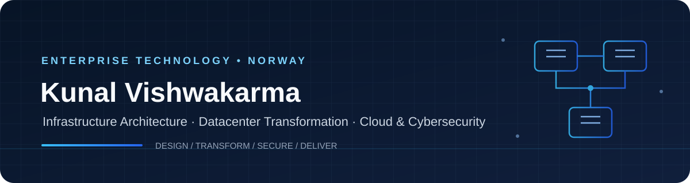

### Infrastructure Architecture & Transformation Professional
**Enterprise Infrastructure · Datacenter Migration · Hybrid Cloud · Networking · Technical Delivery**

  
  
  

Oslo, Norway · 20+ years in enterprise IT infrastructure and technology delivery

---

## Professional profile

I am an enterprise IT infrastructure professional with more than 20 years of experience spanning infrastructure architecture, datacenter services, networking, hybrid-cloud environments and technical project delivery. I bring together architecture thinking and delivery execution: understanding the existing environment, shaping a practical target state, coordinating technical teams and suppliers, managing migration risk, and supporting transition into operations.

My professional work has included datacenter migration and decommissioning initiatives across the **United States, Norway and APAC**, as well as infrastructure modernisation and network delivery in complex enterprise environments.

## Selected career strengths

- **Datacenter transformation:** experience contributing to migration, consolidation and decommissioning initiatives across multiple regions.
- **Infrastructure architecture:** translating technical and operational requirements into infrastructure designs, dependencies, resilience considerations and implementation plans.
- **Hybrid infrastructure and cloud:** experience across on-premises/datacenter platforms and Azure-related hybrid-cloud initiatives.
- **Network delivery:** infrastructure and network services, connectivity, security boundaries and coordination across technical workstreams.
- **End-to-end delivery:** technical project coordination, planning, change and risk management, stakeholder engagement, supplier coordination and operational handover.

*These are summaries of professional experience, not claims that every example in the repositories was deployed in a production environment. Specific project metrics and customer details are intentionally omitted.*

## Technical portfolio

The five repositories below show how I structure technical thinking and communicate reusable engineering practices. The lab repositories are independent learning material; the datacenter and architecture examples are anonymised or synthetic rather than reproductions of employer/customer work.

| Portfolio area | What it demonstrates |
|---|---|
| 🏗️ **[Infrastructure Architecture](https://github.com/Kunalvishwakarma/Infrastructure-Architecture)** | Architecture principles, hybrid reference design, resilience, operational readiness and design trade-offs |
| 🖥️ **[Datacenter Transformation](https://github.com/Kunalvishwakarma/Datacenter-Transformation)** | Migration lifecycle, discovery, dependency mapping, wave planning, cutover, rollback and decommission controls |
| ☁️ **[Azure Cloud Labs](https://github.com/Kunalvishwakarma/Azure-Cloud-Labs)** | Azure governance, network design, identity, monitoring, backup/recovery and infrastructure-as-code learning |
| 🌐 **[Network Security Labs](https://github.com/Kunalvishwakarma/Network-Security-Labs)** | Segmentation, DNS, packet analysis, firewall governance and troubleshooting exercises |
| 🏭 **[OT Cybersecurity Labs](https://github.com/Kunalvishwakarma/OT-Cybersecurity-Labs)** | IEC 62443 concepts, Purdue model, zones/conduits, OT risk and safe lab-based learning |

## Core technical capabilities

- **Infrastructure:** enterprise platforms, datacenter services, lifecycle management, availability, backup, disaster recovery and operational readiness
- **Transformation:** discovery, dependency mapping, migration planning, cutover/rollback, decommissioning and transition
- **Cloud:** Microsoft Azure infrastructure, governance, identity, security and hybrid connectivity
- **Networking:** LAN/WAN, routing and switching, VPN, DNS, load balancing and network security
- **Security:** infrastructure security, segmentation, access governance, monitoring and OT cybersecurity concepts
- **Delivery:** technical project management, stakeholder and supplier coordination, RAID, change governance, RFP/SoW and operational handover

<strong>Certifications and professional development</strong>

Credentials listed in my professional profile include Microsoft Azure Administrator Associate, Microsoft Azure Security Engineer Associate, PRINCE2 Agile, ITIL Foundation, Cisco CCNA Voice, BICSI Datacenter Design & Infrastructure, Aviatrix Multi-Cloud and Alibaba Cloud certifications.

Certification status and validity can change; please refer to the relevant issuing organisation for current verification.

## Selected portfolio artefacts

- [Hybrid infrastructure reference architecture](https://github.com/Kunalvishwakarma/Infrastructure-Architecture/blob/main/docs/HYBRID-REFERENCE-ARCHITECTURE.md)
- [Synthetic datacenter migration case study](https://github.com/Kunalvishwakarma/Datacenter-Transformation/blob/main/case-study/SYNTHETIC-HYBRID-DATACENTER-MIGRATION.md)
- [Azure Bicep network starter](https://github.com/Kunalvishwakarma/Azure-Cloud-Labs/blob/main/bicep/network/main.bicep)
- [Network segmentation lab](https://github.com/Kunalvishwakarma/Network-Security-Labs/tree/main/labs/01-segmentation-design)
- [Synthetic OT zones-and-conduits case study](https://github.com/Kunalvishwakarma/OT-Cybersecurity-Labs/blob/main/case-studies/SYNTHETIC-ZONES-AND-CONDUITS.md)

## GitHub activity

  
  

  

Activity cards are provided by third-party services and may be unavailable or rate-limited. Language statistics reflect public repositories, not a formal assessment of professional skills.

## Connect

---

Responsible publication: repositories contain independent learning material, conceptual designs and synthetic examples. They do not disclose customer or employer confidential information and do not imply employer endorsement. Labs must not be represented as production deployments unless separately executed and validated.
